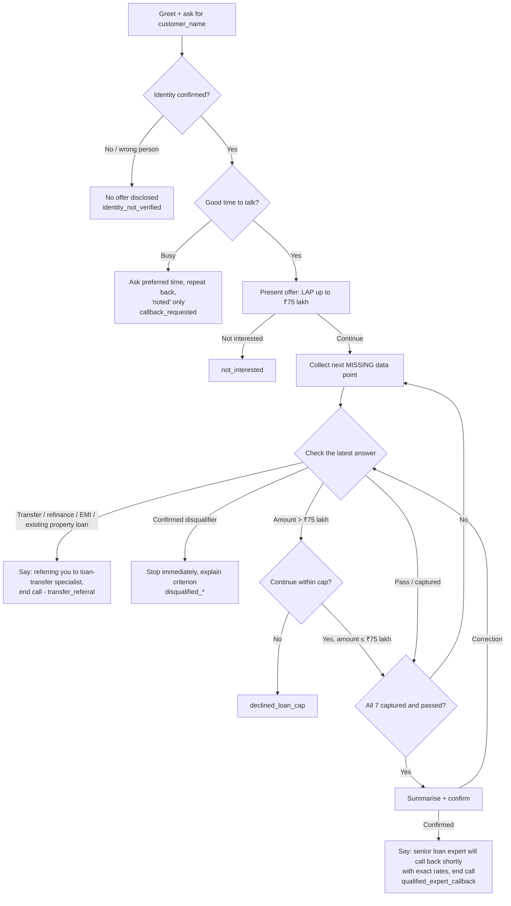

# Conversation Flow and State Management

## Flow

The busy, not-interested, and transfer exits can happen at any point after verification, not only at the steps shown. Every exit ends with a goodbye and Retell's `end_call` tool. The agent never transfers a call.

## State model

The agent keeps no external memory. Every turn, the prompt tells the model to reread the call transcript, including the customer's latest words, and rebuild this checklist. On Retell the transcript replaces the `conversation_history` and `customer_utterance` variables; PV-01 checks this.

| Item | Values |
|---|---|
| `identity_verified` | yes / no |
| `transfer_trigger` | yes / no |
| each of the 7 data points | `missing` · `captured(value)` · `needs_clarification` · `failed` |

Rebuilding from the transcript each turn, rather than tracking a running counter, means that:
- **Out-of-order answers** are captured whenever they appear, including several in one sentence.
- **Corrections** work naturally: the latest clear answer wins and is checked again.
- **No repeated questions:** the next question is always the first `missing` or `needs_clarification` item in the default order (property type → ownership → documents → loan amount → occupation and income → property value → tenure).

## Transition rules

| From | Trigger | To |
|---|---|---|
| any data point | value captured and passes | next missing data point |
| any data point | vague or partial answer | `needs_clarification` → one targeted question |
| any data point | possibly misheard disqualifier | repeat back once to confirm |
| any data point | confirmed disqualifier | end immediately (`disqualified_*`) |
| loan amount | above ₹75 lakh | cap sub-flow: explain the limit → continue within it, or `declined_loan_cap` |
| any point after verification | transfer trigger | `transfer_referral` |
| any point | busy | `callback_requested` |
| collection | customer asks for the expert early | gate refuses → ask for the next missing data point |
| all 7 passed | — | summary → confirmation → `qualified_expert_callback` |

## Preventing a premature qualified close

The qualified close ("a senior loan expert will call you back shortly") is protected in three places:
1. **Hard rule 6** in the prompt's top rules section.
2. **The qualification gate**, an explicit all-of checklist that must hold before Steps 5 and 6.
3. **The summary confirmation**: the agent reads back all seven values before the qualified close, which exposes any value that is missing.

There is also an explicit instruction for an early "just connect me" request: politely decline and ask for the next missing data point.

## Disqualification versus clarification

The agent disqualifies only on a **clear, confirmed** answer. Ambiguous inputs ("land", "a plot", "around 10 to 20 years", "some cash, some bank") trigger one clarifying question instead. This avoids rejecting an eligible customer because of a speech-recognition error.

## Transfer vs. callback vs. scheduling

| Approach | Used? | Why |
|---|---|---|
| Live transfer of the current call | No | The brief requires a callback. Retell transfers also don't work on web calls. |
| Inform the customer, then end the call | **Yes**, for the qualified close and loan-transfer referrals | This is the conversation behaviour the brief requires. Nothing is actually sent: see [requirements.md](requirements.md#conversation-behaviour-vs-system-reality). |
| Schedule the callback in an external system | No (not configured) | No CRM, calendar, or webhook exists. The outcome is only recorded in post-call extraction. |
